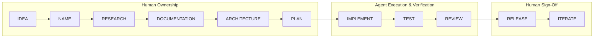
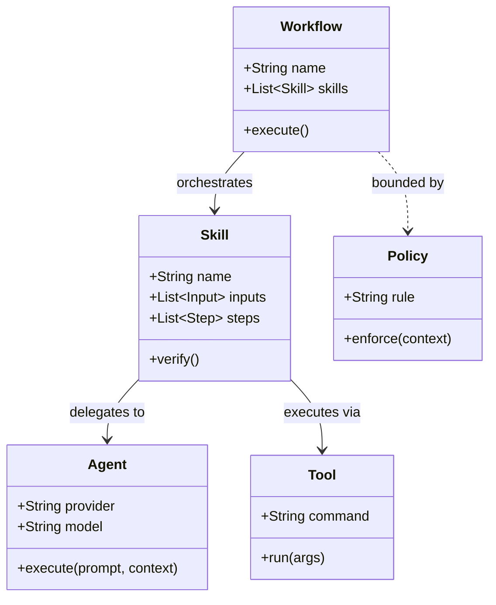
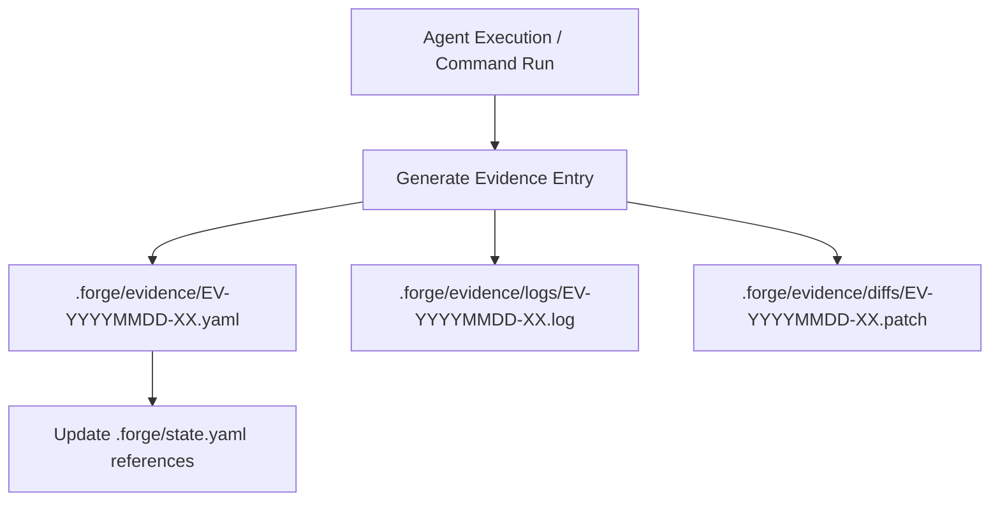
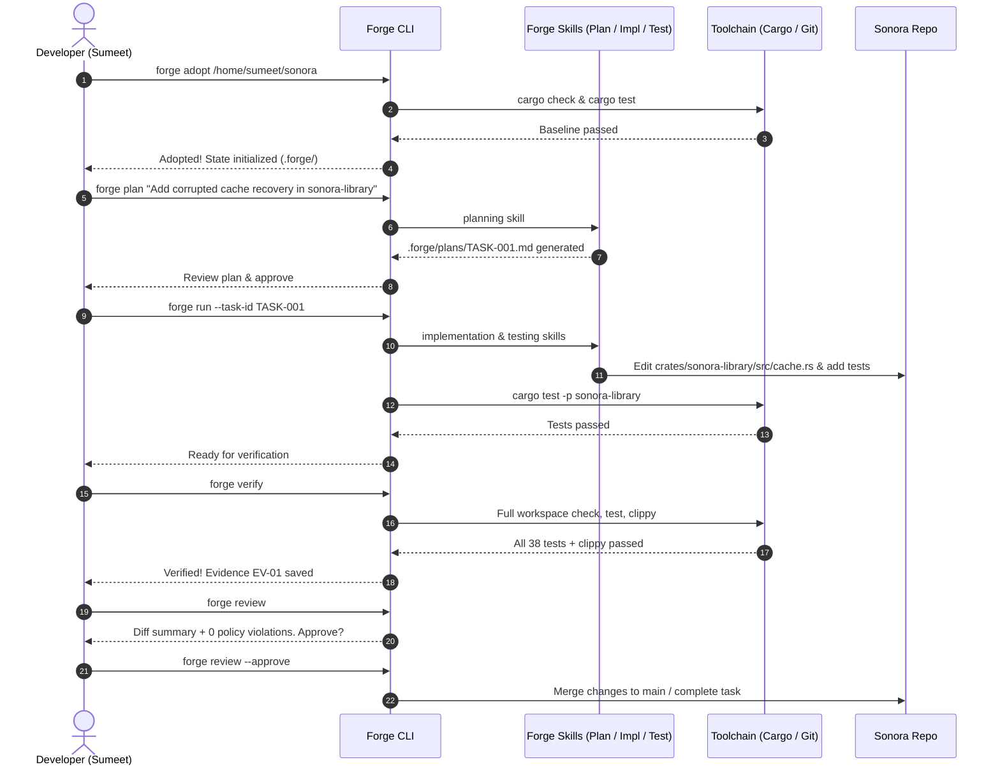
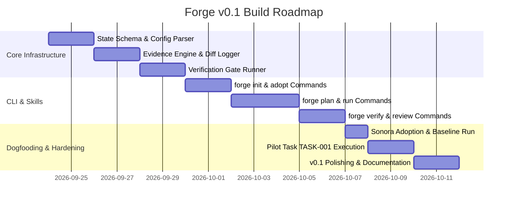

# Forge v0.1 Technical Specification
## Personal Software Factory for Solo Engineering

---

## 1. Executive Summary & Philosophy

**Forge** is a personal software factory engineered for a solo developer. Its objective is to transform an individual developer's end-to-end engineering workflow into a repeatable, deterministic, partially automated system.

Solo developers face a common failure mode when working with autonomous agents: *context drift, undisciplined edits, lack of audit trails, and opaque decision-making*. Forge solves this by enforcing a structured lifecycle where the **human retains full ownership over intent and architectural decisions**, while **agents execute bounded tasks against explicit state, producing verifiable evidence at every step**.



### 1.1 Core Principles

1. **Human owns intent and important decisions**: Architecture, feature scope, risk tolerance, and release approvals are strictly human-governed.
2. **Agents execute well-defined tasks**: Agents receive explicit specifications, bound input files, and constrained exit conditions.
3. **Every meaningful action produces evidence**: No state change or verification is accepted without an inspectable log, diff, command output, or structured artifact.
4. **Project state is explicit and machine-readable**: Single source of truth stored in version control (`.forge/state.yaml`).
5. **Deterministic and reproducible workflows**: Pipeline transitions rely on defined gates rather than ad-hoc agent claims.
6. **Simple, local-first tooling**: Operates as a single standalone CLI binary/tool with zero required daemon or cloud dependencies.
7. **Reuse existing coding agents and developer tools**: Interfaces directly with proven coding CLIs (such as Agy, Claude Code, OpenCode) and standard toolchains (`cargo`, `git`, `npm`, `pytest`).
8. **Modular and swappable**: Execution engines, verification adapters, and linters are decoupled via standardized CLI/tool adapters.
9. **Zero unnecessary infrastructure**: No vector databases, microservices, web apps, or orchestration clusters.
10. **Useful for real projects**: Designed for real codebases (beginning with [Sonora](file:///home/sumeet/sonora), a Rust/Tauri workspace).

---

## 2. System Model & Architecture

Forge establishes an explicit separation of concerns across five core primitives:



### 2.1 Definitions & Boundaries

- **Skills**: Parameterized, repeatable engineering capabilities (e.g., `planning`, `implementation`, `testing`). A skill defines *what steps to take, which tools to invoke, and what evidence to produce*.
- **Agents**: Pluggable LLM execution drivers (e.g., local Antigravity/Agy agent, Claude Code CLI, OpenAI API harness) that execute a skill's prompt within a controlled subshell/sandbox. Agents do not decide workflow paths; they execute bounded steps within a skill.
- **Tools**: Deterministic external binaries and environments (`git`, `cargo`, `rustc`, `npm`, `ripgrep`, linters, test harnesses).
- **Workflows**: Deterministic state machine pipelines composed of sequential skills and verification gates (e.g., `adopt -> plan -> implement -> verify -> review`).
- **Policies**: Hard invariant checks evaluated before and after execution (e.g., git branch cleanliness, protected path access, diff size limits, test pass rate).

---

## 3. Project State Model

### 3.1 State Representation (`.forge/state.yaml`)

Forge maintains all project metadata inside a `.forge/` directory at the repository root.

**Choice of YAML over JSON**:
- **Human Readability & Reviewability**: YAML supports comments, multi-line strings, and clean git diffs, making human inspection and manual edits trivial when resolving blocked states.
- **Schema Validation**: Evaluated against a strict JSON Schema at runtime to prevent corruption or typing ambiguities.

### 3.2 State Schema (`.forge/state.yaml`)

```yaml
schema_version: "0.1.0"
project:
  id: "sonora"
  name: "Sonora"
  repo_root: "."
  primary_language: "rust"

lifecycle:
  phase: "IMPLEMENT" # IDEA | NAME | RESEARCH | DOCUMENTATION | ARCHITECTURE | PLAN | IMPLEMENT | TEST | REVIEW | RELEASE | ITERATE
  active_task_id: "TASK-001"

active_run:
  run_id: "RUN-20260923-01"
  agent: "agy"
  started_at: "2026-09-23T12:00:00Z"
  status: "running" # idle | running | blocked | failed | completed

tasks:
  - id: "TASK-001"
    title: "Implement metadata cache validation check"
    phase: "IMPLEMENT"
    status: "in_progress" # pending | in_progress | ready_for_verify | verified | rejected | done
    plan_file: ".forge/plans/TASK-001.md"
    assigned_agent: "agy"
    created_at: "2026-09-23T11:30:00Z"
    updated_at: "2026-09-23T12:00:00Z"
    evidence_ids:
      - "EV-20260923-01"

gates:
  clean_git_tree:
    status: "passed"
    last_checked: "2026-09-23T12:00:00Z"
  implementation_complete:
    status: "pending"
    last_checked: null
  build:
    status: "pending"
    last_checked: null
  tests:
    status: "pending"
    last_checked: null
  lint:
    status: "pending"
    last_checked: null
  review:
    status: "pending"
    last_checked: null
  human_approval:
    status: "pending"
    last_checked: null

verification:
  last_verified_at: null
  overall_status: "unverified" # unverified | passing | failing

review:
  status: "pending" # pending | approved | changes_requested
  reviewer: null
  comments_file: null

release:
  version: "0.1.0"
  tag: null
  status: "unreleased"
```

---

## 4. Evidence Model

Every action executed by Forge or an invoked agent generates structured evidence in `.forge/evidence/<evidence-id>.yaml` and associated raw logs.



### 4.1 Evidence Structure (`.forge/evidence/EV-*.yaml`)

```yaml
id: "EV-20260923-01"
task_id: "TASK-001"
timestamp: "2026-09-23T12:05:30Z"
triggered_by: "forge run"
agent: "agy"

commands_executed:
  - command: "cargo test -p sonora-library --test cache_validation"
    exit_code: 0
    duration_ms: 1420
    stdout_log: ".forge/evidence/logs/EV-20260923-01-cargo-test.log"
    stderr_log: null

changes:
  files_modified:
    - "crates/sonora-library/src/cache.rs"
    - "crates/sonora-library/tests/cache_validation.rs"
  files_created: []
  files_deleted: []
  diff_stat: "+42 -6"
  patch_file: ".forge/evidence/diffs/EV-20260923-01.patch"

verification_results:
  build:
    command: "cargo check --workspace --all-targets"
    status: "passed"
    exit_code: 0
  tests:
    command: "cargo test --workspace"
    status: "passed"
    exit_code: 0
    total: 38
    passed: 38
    failed: 0
  lint:
    command: "cargo clippy --workspace --all-targets -- -D warnings"
    status: "passed"
    exit_code: 0

agent_summary: >
  Implemented CRC32 header validation for cached metadata files in `sonora-library`.
  Added regression tests verifying that truncated cache entries are discarded and re-indexed.
```

---

## 5. Verification Gates

Verification gates act as deterministic circuit breakers between lifecycle phases. An agent cannot transition a task to `ready_for_review` or `done` without all required gates passing.

| Gate | Verification Command / Criterion | Failure Mode |
|---|---|---|
| **1. Git Cleanliness** | `git diff --quiet` (or managed branch isolation) | Abort: uncommitted extraneous changes |
| **2. Implementation Complete** | Plan task checklist items checked & non-empty git diff | Block: task criteria not fulfilled |
| **3. Build** | Project build command exits 0 (e.g. `cargo check --all-targets`) | Fail: compiler/syntax errors |
| **4. Tests** | Full test suite exits 0 (e.g. `cargo test --workspace`) | Fail: test regressions |
| **5. Lint / Static Analysis** | Zero linter warnings/errors (e.g. `cargo clippy -- -D warnings`) | Fail: code style or safety violations |
| **6. Automated Review** | `review` skill outputs 0 critical/high findings | Block: architecture or policy breach |
| **7. Human Approval** | Explicit confirmation via `forge review --approve` | Hold: human sign-off required |

Project-specific commands are configured via `.forge/config.yaml`:
```yaml
toolchain:
  build_cmd: "cargo check --workspace --all-targets"
  test_cmd: "cargo test --workspace"
  lint_cmd: "cargo clippy --workspace --all-targets -- -D warnings"
  format_check_cmd: "cargo fmt --all -- --check"
```

---

## 6. v0.1 CLI Specification

The Forge CLI (`forge`) provides seven essential commands:

```
forge
├── init        # Initialize a new Forge project from scratch
├── adopt       # Adopt an existing codebase into Forge management
├── status      # Inspect lifecycle phase, active tasks, gates, and evidence
├── plan        # Generate or refine structured execution plans for a task
├── run         # Execute planned task using an assigned agent/skill
├── verify      # Run deterministic verification gates across build/tests/lints
└── review      # Generate diff analysis and prompt developer for sign-off
```

### 6.1 `forge init`
- **Purpose**: Initialize a brand new software project within the Forge lifecycle.
- **Arguments**: `[project-name] [--language <lang>] [--template <tmpl>]`
- **Actions**:
  1. Creates project root directory.
  2. Initializes Git repository if not already initialized.
  3. Creates `.forge/` directory structure with default `state.yaml`, `config.yaml`, and documentation templates.
  4. Sets lifecycle phase to `IDEA`.

### 6.2 `forge adopt`
- **Purpose**: Non-destructively bring an existing repository under Forge management.
- **Arguments**: `[path] [--detect]`
- **Actions**:
  1. Inspects repository root, detects build toolchain (`Cargo.toml`, `package.json`, `pyproject.toml`, etc.).
  2. Generates `.forge/config.yaml` with detected verification commands.
  3. Initializes `.forge/state.yaml` reflecting current repo state in phase `ARCHITECTURE` or `PLAN`.
  4. Runs initial baseline verification (`build`, `test`, `lint`) and records baseline evidence `EV-00000000-00`.
  5. Leaves all source files and git history untouched.

### 6.3 `forge status`
- **Purpose**: Display a human-readable and machine-parseable dashboard of project state.
- **Arguments**: `[--json]`
- **Actions**:
  1. Reads `.forge/state.yaml` and latest `.forge/evidence/`.
  2. Outputs:
     - Current project name and lifecycle phase.
     - Active task, description, and status.
     - Status of each verification gate (Green/Red/Pending).
     - Recent agent runs and uncommitted diff summary.

### 6.4 `forge plan`
- **Purpose**: Run the `planning` skill to produce or update a structured task execution plan.
- **Arguments**: `"<task-description>" [--task-id <id>] [--agent <agent-name>]`
- **Actions**:
  1. Allocates `TASK-XXX` in `.forge/state.yaml`.
  2. Ingests current codebase context, relevant architecture docs, and task description.
  3. Invokes planning agent to generate `.forge/plans/TASK-XXX.md` containing:
     - Objective & scope boundaries
     - Affected files and modules
     - Concrete step-by-step implementation edits
     - Test and verification criteria
  4. Sets task status to `pending` awaiting `forge run`.

### 6.5 `forge run`
- **Purpose**: Execute an active task plan using the designated skill and agent.
- **Arguments**: `[--task-id <id>] [--agent <agent-name>] [--auto-verify]`
- **Actions**:
  1. Enforces pre-execution policy: checks clean git worktree or creates task branch `forge/TASK-XXX`.
  2. Ingests `.forge/plans/TASK-XXX.md` and passes execution prompt to the agent.
  3. Monitors execution, captures stdout/stderr, tracks touched files.
  4. Collects patch diff and generates `.forge/evidence/EV-*.yaml`.
  5. Updates `.forge/state.yaml` task status to `ready_for_verify`.
  6. If `--auto-verify` is set, triggers `forge verify`.

### 6.6 `forge verify`
- **Purpose**: Deterministically run all configured verification gates for the current task.
- **Arguments**: `[--strict]`
- **Actions**:
  1. Runs `toolchain.build_cmd`, `toolchain.test_cmd`, `toolchain.lint_cmd`, `toolchain.format_check_cmd`.
  2. Captures all outputs and exit codes into evidence log.
  3. Updates gate statuses in `.forge/state.yaml`.
  4. If all pass: sets task status to `verified`.
  5. If any fail: sets task status to `rejected`, records failing output into `.forge/evidence/` for agent feedback.

### 6.7 `forge review`
- **Purpose**: Synthesize evidence and present changes for human review and final approval.
- **Arguments**: `[--approve] [--reject "<reason>"]`
- **Actions**:
  1. Runs the `review` skill to produce a structured critique:
     - Scope compliance against `.forge/plans/TASK-XXX.md`
     - Potential edge cases, performance regressions, or security concerns
     - Changed file summary and test coverage confirmation
  2. If called without flags: outputs review findings and patch summary, prompting developer for input.
  3. If `--approve`: marks gate `human_approval: passed`, merges task branch / updates task to `done`, advances lifecycle.
  4. If `--reject`: appends feedback to plan and reverts/holds changes for remediation.

---

## 7. v0.1 Core Skills Specification

Forge defines exactly six foundational skills for v0.1:

```
1. project-init    --> Workspace bootstrapping and toolchain detection
2. research        --> Codebase & domain exploration with structured synthesis
3. planning        --> Concrete step-by-step plan & boundary definition
4. implementation  --> Bounded code modifications following the plan
5. testing         --> Regression test creation, execution, and coverage analysis
6. review          --> Diff analysis, scope adherence check, and risk auditing
```

---

### 7.1 Skill: `project-init`

- **Purpose**: Bootstrap project metadata, detect toolchains, and configure Forge operating parameters for new or adopted repositories.
- **Inputs**:
  - Target directory path
  - Adoption mode (`new` or `adopt`)
  - Optional user-specified toolchain overrides
- **Required Context**:
  - Root directory listing, manifest files (`Cargo.toml`, `package.json`, `Makefile`, etc.), `.git` status.
- **Execution Steps**:
  1. Scan workspace for manifest and configuration files.
  2. Detect build system, test runner, linter, and source directory layout.
  3. Create `.forge/` directory, `.forge/config.yaml`, `.forge/state.yaml`, and `.forge/evidence/`.
  4. Execute baseline build and test commands to verify environment readiness.
- **Outputs**:
  - `.forge/config.yaml`
  - `.forge/state.yaml`
  - `.forge/evidence/EV-00000000-00.yaml` (baseline evidence)
- **Evidence Produced**:
  - Initial toolchain detection log and baseline test run output.
- **Success Criteria**:
  - `.forge/` exists, configuration is valid YAML matching schema, and baseline check passes or records known initial state.
- **Failure Behavior**:
  - If toolchain cannot be detected or baseline fails completely, generates template `.forge/config.yaml` and alerts developer with actionable guidance.

---

### 7.2 Skill: `research`

- **Purpose**: Explore codebases, APIs, dependencies, or architectural alternatives to answer a specific technical question without modifying code.
- **Inputs**:
  - Research prompt / query
  - Target files, modules, or domain boundaries
- **Required Context**:
  - Project architecture docs, crate/package dependency graph, relevant source files, external docs if applicable.
- **Execution Steps**:
  1. Identify search targets using file search / symbol lookup.
  2. Read and analyze candidate implementations and dependencies.
  3. Synthesize findings, trade-offs, and concrete recommendations.
  4. Write research report to `.forge/research/<TOPIC>.md`.
- **Outputs**:
  - Markdown report at `.forge/research/<TOPIC>.md`.
- **Evidence Produced**:
  - List of inspected files, symbols referenced, search terms used.
- **Success Criteria**:
  - Report contains clear findings, trade-offs, file:line references, and actionable next steps.
- **Failure Behavior**:
  - If ambiguous or files missing, documents the unknowns and requests human clarification rather than guessing.

---

### 7.3 Skill: `planning`

- **Purpose**: Translate a feature request, bug report, or refactor goal into a strict, bounded execution plan.
- **Inputs**:
  - Task description
  - Associated research doc (optional)
  - Current `.forge/state.yaml`
- **Required Context**:
  - Architecture documents, relevant source files, existing tests, project engineering policies.
- **Execution Steps**:
  1. Determine exact files to be created, modified, or deleted.
  2. Define boundary constraints (what the agent MUST NOT touch).
  3. Break task down into numbered, atomic steps.
  4. Specify required test cases and verification criteria.
  5. Write plan to `.forge/plans/TASK-XXX.md`.
- **Outputs**:
  - `.forge/plans/TASK-XXX.md`.
  - Updated task entry in `.forge/state.yaml`.
- **Evidence Produced**:
  - Generated plan document and diff against previous plan if iterative.
- **Success Criteria**:
  - Plan is explicit enough that an agent can execute it without making unconstrained architectural decisions.
- **Failure Behavior**:
  - If scope is overly broad or violates policies, rejects task and requests decomposition from human.

---

### 7.4 Skill: `implementation`

- **Purpose**: Execute code modifications strictly according to an approved `.forge/plans/TASK-XXX.md`.
- **Inputs**:
  - Plan file path (`.forge/plans/TASK-XXX.md`)
  - Target source files specified in the plan
- **Required Context**:
  - Plan instructions, affected source files, target library APIs, project coding policies.
- **Execution Steps**:
  1. Verify working tree is clean or isolated on task branch.
  2. Apply edits file-by-file matching plan specifications.
  3. Validate edits against scope boundaries (ensure no unauthorized files modified).
  4. Perform local incremental syntax/build check.
  5. Capture unified git diff.
- **Outputs**:
  - Modified code files in working tree / task branch.
  - Patch file `.forge/evidence/diffs/EV-*.patch`.
- **Evidence Produced**:
  - Unified diff, list of touched files, build sanity output.
- **Success Criteria**:
  - Code compiles without syntax errors; diff strictly matches planned scope boundaries.
- **Failure Behavior**:
  - If implementation gets stuck or compilation fails irrecoverably, rolls back changes to task start point, logs failure details, and marks task `blocked`.

---

### 7.5 Skill: `testing`

- **Purpose**: Write new unit/integration tests for implemented changes and execute full verification suite.
- **Inputs**:
  - Implemented changes / diff
  - Plan test specifications (`.forge/plans/TASK-XXX.md`)
- **Required Context**:
  - Test framework conventions, existing test suites, test utility helpers.
- **Execution Steps**:
  1. Author unit/integration tests covering new or modified behavior.
  2. Author edge-case and regression tests.
  3. Execute test suite via configured `toolchain.test_cmd`.
  4. Collect pass/fail counts, execution time, and stdout/stderr.
- **Outputs**:
  - Test files created/updated.
  - Test run log in `.forge/evidence/logs/`.
- **Evidence Produced**:
  - Structured test execution metrics (total, passed, failed, duration) stored in evidence YAML.
- **Success Criteria**:
  - All existing and new tests pass with 0 failures and 0 flakes.
- **Failure Behavior**:
  - If tests fail, logs exact stack traces and failure output to evidence file; marks `gates.tests: failed`.

---

### 7.6 Skill: `review`

- **Purpose**: Conduct automated diff review, policy compliance check, and present structured summary for human approval.
- **Inputs**:
  - Task diff (`.forge/evidence/diffs/EV-*.patch`)
  - Plan file (`.forge/plans/TASK-XXX.md`)
  - Test and verification evidence
- **Required Context**:
  - Engineering policies (`.forge/policies.yaml`), project architecture guidelines.
- **Execution Steps**:
  1. Check diff against plan: flag any unexpected file changes or deleted code.
  2. Scan diff for security anti-patterns (hardcoded credentials, unwrap abuse, unsafe blocks).
  3. Verify that new functionality has accompanying tests.
  4. Summarize behavioral changes and open questions for the developer.
  5. Write report to `.forge/reviews/TASK-XXX-review.md`.
- **Outputs**:
  - `.forge/reviews/TASK-XXX-review.md`.
  - Review status updated in `.forge/state.yaml`.
- **Evidence Produced**:
  - Review report containing findings, risk score (Low/Med/High), and policy checklist.
- **Success Criteria**:
  - Review report generated with clear go/no-go recommendation for human sign-off.
- **Failure Behavior**:
  - If critical policy violation detected (e.g. secret leaked, unauthorized dependency added), blocks gate and flags immediate alert.

---

## 8. Engineering Policies

Forge v0.1 enforces a compact, mandatory policy set:

```yaml
policies:
  git_safety:
    no_direct_main_commit: true
    require_clean_tree_before_run: true
    task_branch_pattern: "forge/{{task_id}}"
    never_force_push: true

  human_governance:
    require_plan_approval: true
    require_release_approval: true
    require_destructive_action_confirm: true

  quality_and_tests:
    zero_failing_tests: true
    zero_linter_warnings: true
    no_ignored_tests_without_issue: true

  dependency_discipline:
    lockfile_must_be_updated: true
    no_new_unapproved_dependencies: true
    max_binary_size_delta_kb: 500

  security_basics:
    no_hardcoded_secrets: true
    no_unbounded_shell_eval: true
    rust_unsafe_must_have_safety_comment: true

  scope_control:
    max_files_per_task: 10
    max_diff_lines_per_task: 500
```

### Policy Enforcement Mechanics
- **Pre-execution hooks**: Before `forge run`, git status and scope limits are verified. If dirty or exceeding limits, execution halts.
- **Post-execution hooks**: Before `forge verify` passes, linters, git diff bounds, and secret scanners run deterministically.

---

## 9. Minimal Repository Structure

The Forge repository itself is lightweight and modular:

```
forge/
├── Cargo.toml                  # Rust CLI workspace definition (or Python pyproject.toml)
├── Cargo.lock
├── README.md
├── docs/
│   ├── 00-forge-v0.1-spec.md   # This specification
│   └── architecture.md
├── crates/ (or src/)
│   ├── forge-cli/              # CLI entry point (subcommands: init, adopt, status, etc.)
│   ├── forge-core/             # State machine, schema validation, config loader
│   ├── forge-skills/           # Skill executors (init, research, plan, impl, test, review)
│   ├── forge-evidence/         # Evidence generator, diff capture, log recorder
│   ├── forge-adapters/         # Toolchain & Agent drivers (cargo, git, agy, claude)
│   └── forge-policies/         # Policy evaluation engine
└── tests/
    ├── cli_tests.rs            # CLI integration tests
    └── adoption_tests.rs       # Test adopting real repos
```

### In-Target Project Structure (e.g. inside `.forge/` in Sonora):
```
sonora/
├── .forge/
│   ├── state.yaml              # Active lifecycle and task state
│   ├── config.yaml             # Project-specific toolchain and adapter commands
│   ├── plans/                  # Task execution plans (TASK-001.md, ...)
│   ├── research/               # Technical investigation writeups
│   ├── reviews/                # Automated and manual review notes
│   └── evidence/
│       ├── EV-20260923-01.yaml # Structured run evidence
│       ├── logs/               # Raw command stdout/stderr
│       └── diffs/              # Patch files
```

---

## 10. Sonora Dogfooding Pilot Design

To validate Forge v0.1 in a real-world setting, it will be dogfooded on **Sonora** (`/home/sumeet/sonora`), a modular Rust/Tauri music player.



### 10.1 Pilot Task Definition

- **Target Component**: [`crates/sonora-library`](file:///home/sumeet/sonora/crates/sonora-library)
- **Task**: `TASK-001: Implement Corrupted Audio Cache Recovery and Header Checksum Validation`
- **Rationale**:
  - Realistic, production-grade enhancement.
  - Bounded scope: localized to `sonora-library` and its test suite.
  - High verification rigor: involves binary serialization, error handling, and unit/regression tests.

### 10.2 Starting State
- Clean Git repository on branch `main`.
- Sonora workspace builds with `cargo check --workspace` and passes existing unit tests (`cargo test --workspace`).
- No `.forge/` directory exists yet.

### 10.3 Pilot Step-by-Step Workflow

1. **Adoption**:
   ```bash
   forge adopt /home/sumeet/sonora
   ```
   *Result*: Detects Rust workspace, configures `cargo` commands in `.forge/config.yaml`, generates baseline evidence `EV-00000000-00`.

2. **Planning**:
   ```bash
   forge plan "Add CRC32 checksum validation to cached album art & metadata; auto-evict and re-index corrupted cache files"
   ```
   *Result*: Produces `.forge/plans/TASK-001.md` detailing:
   - Modifications to `crates/sonora-library/src/cache.rs`
   - Added unit test in `crates/sonora-library/tests/cache_validation.rs`
   - Bound: do NOT alter audio decoding pipeline in `sonora-audio` or UI in `apps/`.

3. **Human Approval of Plan**:
   Developer inspects `.forge/plans/TASK-001.md`, validates scope, and runs:
   ```bash
   forge run --task-id TASK-001
   ```

4. **Agent Execution & Evidence Generation**:
   The agent applies the changes, runs incremental tests, and outputs patch to `.forge/evidence/diffs/EV-20260923-01.patch`.

5. **Deterministic Verification**:
   ```bash
   forge verify
   ```
   Forge runs:
   - `cargo check --workspace --all-targets`
   - `cargo test -p sonora-library`
   - `cargo clippy -p sonora-library -- -D warnings`
   *Result*: All gates pass; `.forge/state.yaml` updated to `verified`.

6. **Review & Human Sign-off**:
   ```bash
   forge review
   forge review --approve
   ```

### 10.4 Success Criteria & Proof of Utility
Forge is proven useful if and only if:
1. **Zero Context Drift**: The agent touched zero files outside `crates/sonora-library`.
2. **Deterministic Audit Trail**: The developer can inspect exact commands run, duration, and diff in `.forge/evidence/`.
3. **No Hallucinated Pass**: The verification gate ran real `cargo` processes and recorded real exit codes.
4. **Friction Reduction**: The developer spent time only on task intent and diff sign-off, without manually coordinating terminal commands and prompts.

---

## 11. Explicit Non-Goals (v0.1)

To maintain focus, velocity, and strict local-first reliability, the following are explicit **non-goals** for Forge v0.1:

- ❌ **Custom LLM training or fine-tuning**: Forge integrates with existing standard coding models via standard APIs/CLIs.
- ❌ **Agent marketplace or plugin store**: Fixed set of 6 foundational skills; no third-party plugin ecosystem in v0.1.
- ❌ **Web UI / Graphical Dashboard**: Forge is exclusively a command-line tool (`forge`). All state is inspectable in terminal and text files.
- ❌ **Distributed infrastructure or cloud daemons**: No central server, background daemon, Docker requirement, or Kubernetes cluster.
- ❌ **Vector databases / Semantic embeddings**: Code search and context retrieval use standard AST parsers, `ripgrep`, and file path indexing.
- ❌ **Autonomous production releases**: Forge never automatically deploys or publishes releases without explicit human `forge review --approve`.
- ❌ **Unconstrained agent swarms**: No open-ended multi-agent debates or autonomous self-spawning agents. Single executor per skill.

---

## 12. Technical Trade-Offs & Decisions

| Decision | Chosen Approach | Alternative Considered | Rationale |
|---|---|---|---|
| **State Storage** | Local `.forge/state.yaml` | SQLite / Embedded DB | YAML is human-readable, easily diffed in Git, and directly editable during manual recovery. Schema validation ensures structural integrity. |
| **CLI Runtime** | Rust (or single Python binary) | Web / Electron / Node service | Immediate startup time (<10ms), zero dependency footprint on developer's machine, single static binary distribution. |
| **Agent Interface** | Process-based CLI / Subshell adapter | Deep API / SDK vendor lock-in | Allows swapping between local LLMs, Antigravity CLI (`agy`), Claude Code, or OpenAI scripts without rewriting core engine. |
| **Context Retrieval** | Explicit file paths + `ripgrep` | Vector DB embeddings | Exact symbol search and explicit plan-driven file lists avoid semantic hallucination and require zero indexing infrastructure. |
| **Workflow Control** | Gate-based finite state machine | Autonomous loop | Guarantees deterministic halts when verification fails; prevents infinite retry loops and wasted API tokens. |

---

## 13. Implementation Roadmap (v0.1)



---
*Specification approved for v0.1 implementation.*
