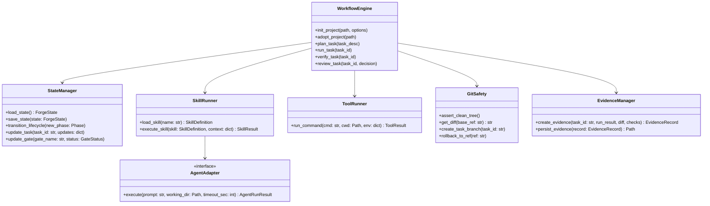
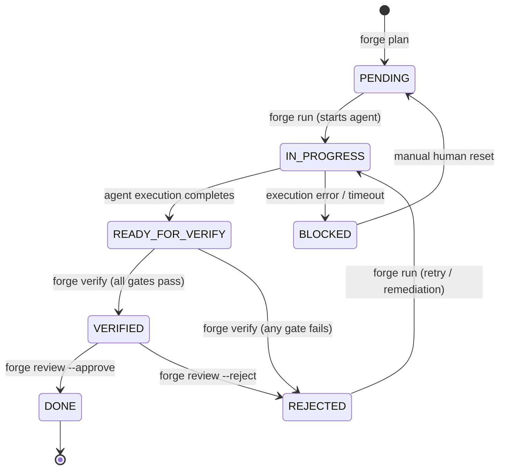
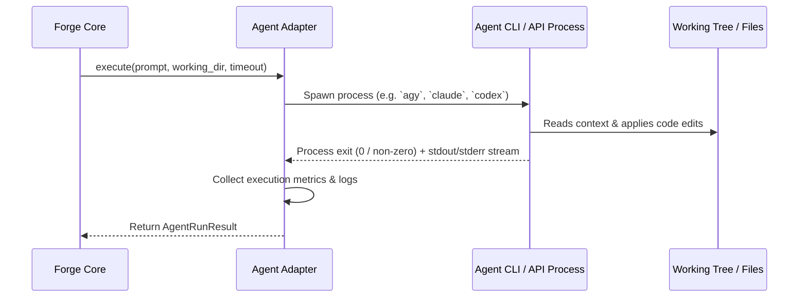
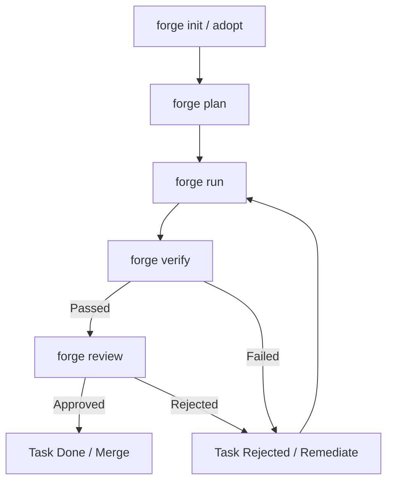
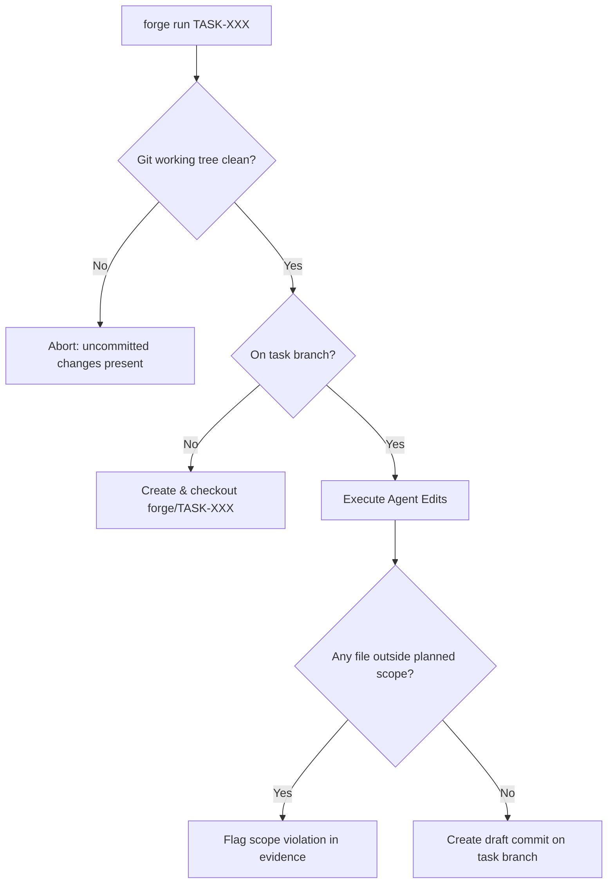

# Forge v0.1 Technical Architecture
## Minimal, Local-First Personal Software Factory

---

## 1. System Architecture & Data Flow

Forge is architected around five strictly separated primitives:
- **Workflows**: Deterministic state-machine pipelines governing the development lifecycle.
- **Skills**: Reusable capabilities defined declaratively (prompts, tool requirements, verification rules).
- **Agents**: Pluggable external execution drivers that run prompts against a working tree.
- **Tools**: Deterministic external operations (`git`, `cargo`, test runners, linters, formatters).
- **Policies**: Hard engineering invariants evaluated before and after execution.

```mermaid
flowchart TD
    subgraph CLI Layer ["CLI Layer (forge)"]
        CLI[forge CLI Entrypoint]
    end

    subgraph Core Engine ["Core Engine"]
        FSM[Workflow & Lifecycle Engine]
        StateMgr[State & Config Manager]
        PolicyEngine[Policy Engine]
        EvidenceEngine[Evidence & Diff Engine]
        SkillLoader[Skill Registry & Loader]
    end

    subgraph Execution Layer ["Execution & Adapter Layer"]
        AgentDriver[Agent Adapter (Subprocess/CLI)]
        ToolRunner[Tool Adapter (Subprocess)]
        GitAdapter[Git Safety Adapter]
    end

    subgraph Storage Layer ["Local Workspace Storage (.forge/)"]
        StateFile[state.yaml]
        ConfigFile[config.yaml]
        EvidenceStore[evidence/EV-*.yaml + logs/]
        PlanStore[plans/TASK-*.md]
        SkillsStore[skills/*.yaml]
    end

    CLI --> FSM
    FSM --> StateMgr
    FSM --> PolicyEngine
    FSM --> SkillLoader
    FSM --> EvidenceEngine

    StateMgr <--> StateFile
    StateMgr <--> ConfigFile
    EvidenceEngine --> EvidenceStore
    SkillLoader <--> SkillsStore
    FSM <--> PlanStore

    SkillLoader --> AgentDriver
    FSM --> ToolRunner
    PolicyEngine --> GitAdapter
    EvidenceEngine --> GitAdapter
    EvidenceEngine --> ToolRunner
```

### 1.1 Data Flow Sequence

1. **Invocation**: Developer triggers a CLI command (e.g., `forge run TASK-001`).
2. **State & Pre-Policy Check**: State is loaded from `.forge/state.yaml`. `PolicyEngine` verifies git working tree cleanliness and task prerequisites.
3. **Skill Resolution**: `SkillLoader` loads the declarative definition for the required skill (e.g., `implementation.yaml`) and compiles prompt templates with task context and plan files.
4. **Execution**: The `AgentDriver` executes the external coding agent against the working tree (or isolated task branch/worktree), capturing all tool calls and stdout/stderr.
5. **Post-Execution & Evidence Capture**: `GitAdapter` captures unified diffs; `ToolRunner` runs deterministic checks; `EvidenceEngine` writes `EV-*.yaml`, stdout/stderr logs, and patch files.
6. **State Update & Gate Evaluation**: State transitions are evaluated against gates and persisted to `.forge/state.yaml`.

---

## 2. Core Modules Specification

Forge v0.1 consists of 8 minimal modules:

```
forge/
└── core/
    ├── state.py         # State model, serialization, JSON Schema validation
    ├── config.py        # Project config (.forge/config.yaml) and toolchain detection
    ├── workflow.py      # Finite state machine and lifecycle gate orchestrator
    ├── skills.py        # Declarative skill loader and execution runner
    ├── agents.py        # Generic agent adapter interface (CLI/subprocess)
    ├── tools.py         # Observable subprocess execution and stream logging
    ├── evidence.py      # Evidence generation, diff extraction, log rotation
    └── git.py           # Git safety layer, branch isolation, clean-tree checks
```



### 2.1 Module Responsibilities & Interfaces

| Module | Responsibility | Primary Inputs | Primary Outputs | Key Dependencies |
|---|---|---|---|---|
| `core.state` | Manages `.forge/state.yaml` schema, validation, atomic writes | Raw YAML file / Python dict | Validated `ForgeState` Pydantic model | `pydantic`, `pyyaml` |
| `core.config` | Loads project toolchain commands and detects language environments | `.forge/config.yaml`, project manifests | `ForgeConfig` object | `pathlib`, `pyyaml` |
| `core.workflow` | State-machine enforcing transitions across IDEA → RELEASE | CLI commands, active state | Task/Lifecycle state updates | `core.state`, `core.git` |
| `core.skills` | Loads declarative skill YAMLs, interpolates Jinja/f-string context | Skill name, task plan, state context | Prepared prompts & skill execution | `core.agents`, `jinja2` |
| `core.agents` | Subprocess driver invoking external coding CLI agents | Prompt text, target directory | Exit code, stdout/stderr, files changed | `subprocess`, `asyncio` |
| `core.tools` | Runs deterministic commands with timeouts & stream logging | Command string, cwd, env vars | `ToolResult` (exit_code, stdout, stderr, duration) | `subprocess`, `time` |
| `core.evidence`| Builds immutable append-only evidence files (`EV-*.yaml`) | Tool results, git diffs, agent summaries | Evidence YAML file, log files, diff patch | `core.state`, `pathlib` |
| `core.git` | Enforces git invariants: clean tree, branch isolation, diff extraction | Git repository path | Branch names, diff patches, status checks | `subprocess` (git CLI) |

---

## 3. Project State Model

### 3.1 Concrete State Data Structures

```python
from enum import Enum
from typing import List, Optional, Dict
from pydantic import BaseModel, Field
from datetime import datetime

class LifecyclePhase(str, Enum):
    IDEA = "IDEA"
    NAME = "NAME"
    RESEARCH = "RESEARCH"
    DOCUMENTATION = "DOCUMENTATION"
    ARCHITECTURE = "ARCHITECTURE"
    PLAN = "PLAN"
    IMPLEMENT = "IMPLEMENT"
    TEST = "TEST"
    REVIEW = "REVIEW"
    RELEASE = "RELEASE"
    ITERATE = "ITERATE"

class TaskStatus(str, Enum):
    PENDING = "pending"
    IN_PROGRESS = "in_progress"
    READY_FOR_VERIFY = "ready_for_verify"
    VERIFIED = "verified"
    REJECTED = "rejected"
    BLOCKED = "blocked"
    DONE = "done"

class GateStatus(str, Enum):
    PENDING = "pending"
    PASSED = "passed"
    FAILED = "failed"
    SKIPPED = "skipped"

class GateState(BaseModel):
    status: GateStatus = GateStatus.PENDING
    last_checked: Optional[datetime] = None
    evidence_id: Optional[str] = None
    failure_reason: Optional[str] = None

class Task(BaseModel):
    id: str
    title: str
    phase: LifecyclePhase
    status: TaskStatus = TaskStatus.PENDING
    plan_file: Optional[str] = None
    assigned_agent: str = "default"
    created_at: datetime = Field(default_factory=datetime.utcnow)
    updated_at: datetime = Field(default_factory=datetime.utcnow)
    evidence_ids: List[str] = Field(default_factory=list)

class ProjectMetadata(BaseModel):
    id: str
    name: str
    repo_root: str = "."
    primary_language: str

class ActiveRun(BaseModel):
    run_id: Optional[str] = None
    agent: Optional[str] = None
    started_at: Optional[datetime] = None
    status: str = "idle" # idle | running | blocked | failed | completed

class VerificationState(BaseModel):
    last_verified_at: Optional[datetime] = None
    overall_status: str = "unverified" # unverified | passing | failing

class ReviewState(BaseModel):
    status: str = "pending" # pending | approved | changes_requested
    reviewer: Optional[str] = None
    comments_file: Optional[str] = None

class ReleaseState(BaseModel):
    version: str = "0.1.0"
    tag: Optional[str] = None
    status: str = "unreleased"

class ForgeState(BaseModel):
    schema_version: str = "0.1.0"
    project: ProjectMetadata
    lifecycle: Dict[str, str] # {"phase": "IMPLEMENT", "active_task_id": "TASK-001"}
    active_run: ActiveRun = Field(default_factory=ActiveRun)
    tasks: List[Task] = Field(default_factory=list)
    gates: Dict[str, GateState] = Field(default_factory=dict)
    verification: VerificationState = Field(default_factory=VerificationState)
    review: ReviewState = Field(default_factory=ReviewState)
    release: ReleaseState = Field(default_factory=ReleaseState)
```

### 3.2 State Transitions and Invariant Matrix



#### Invalid / Prohibited Transitions
1. `PENDING` $\to$ `VERIFIED`: Cannot verify without running implementation.
2. `READY_FOR_VERIFY` $\to$ `DONE`: Cannot approve without passing `forge verify`.
3. `REJECTED` $\to$ `DONE`: Must re-enter `IN_PROGRESS` and be re-verified.
4. `IN_PROGRESS` $\to$ `DONE`: Direct bypass of verification gates is blocked by policy.

---

## 4. Evidence System

The evidence subsystem is strictly append-only, preserving an immutable historical log for every agent run, verification execution, and review decision.

### 4.1 Directory & File Layout
```
.forge/evidence/
├── EV-20260923-01.yaml
├── EV-20260923-02.yaml
├── diffs/
│   ├── EV-20260923-01.patch
│   └── EV-20260923-02.patch
└── logs/
    ├── EV-20260923-01-agent.log
    ├── EV-20260923-01-cargo-check.log
    └── EV-20260923-01-cargo-test.log
```

### 4.2 Evidence Schema (`EV-*.yaml`)

```python
class CommandExecution(BaseModel):
    command: str
    exit_code: int
    duration_ms: int
    stdout_log: str
    stderr_log: Optional[str] = None

class DiffSummary(BaseModel):
    files_modified: List[str] = Field(default_factory=list)
    files_created: List[str] = Field(default_factory=list)
    files_deleted: List[str] = Field(default_factory=list)
    diff_stat: str
    patch_file: str

class VerificationCheckResult(BaseModel):
    command: str
    status: str # passed | failed | skipped
    exit_code: int
    details: Optional[Dict[str, int]] = None # e.g. {"total": 38, "passed": 38, "failed": 0}

class EvidenceRecord(BaseModel):
    id: str # format: EV-YYYYMMDD-XX
    task_id: str
    timestamp: datetime = Field(default_factory=datetime.utcnow)
    triggered_by: str # e.g. "forge run", "forge verify"
    agent: Optional[str] = None
    commands_executed: List[CommandExecution] = Field(default_factory=list)
    changes: DiffSummary
    verification_results: Dict[str, VerificationCheckResult] = Field(default_factory=dict)
    agent_summary: Optional[str] = None
    human_notes: Optional[str] = None
```

---

## 5. Skill System

Skills in Forge are **declarative templates** coupled with execution schemas. A skill can be added or updated in `.forge/skills/<skill-name>.yaml` without modifying Python code.

### 5.1 Declarative Skill Schema

```yaml
# .forge/skills/implementation.yaml
name: "implementation"
version: "0.1.0"
description: "Executes bounded source code edits strictly conforming to a task plan"
required_context:
  - ".forge/plans/{{ task.id }}.md"
  - ".forge/config.yaml"
  - "{{ task.target_files }}"

inputs:
  task_id: string
  plan_file: string

agent_prompt_template: |
  You are an implementation agent working in Forge.
  TASK ID: {{ task.id }}
  TASK TITLE: {{ task.title }}

  Carefully read the plan in: {{ task.plan_file }}

  STRICT CONSTRAINTS:
  1. Only modify files listed in the plan.
  2. Do NOT touch any files outside the plan scope.
  3. Ensure code builds locally before finishing.
  4. Write clean, documented code complying with project policies.

tools_required:
  - git
  - language_toolchain

success_criteria:
  non_empty_diff: true
  scope_adherence: true # Touched files must be a subset of planned files

failure_behavior:
  on_error: "rollback_and_block"
```

### 5.2 Skill Loader & Runtime Contract
1. `SkillRegistry.load(skill_name)` reads YAML from `.forge/skills/` (falling back to Forge built-ins).
2. `SkillRegistry.render_prompt(skill, context)` interpolates task metadata, file paths, and plan contents.
3. The runner passes the rendered prompt and environment bounds to the configured `AgentAdapter`.

---

## 6. Agent Contract

The Agent subsystem defines a minimal, provider-agnostic interface. Forge treats coding agents as **black-box subprocess workers with observable inputs, working directories, and filesystem effects**.



### 6.1 Agent Adapter Interface (`core/agents.py`)

```python
from abc import ABC, abstractmethod
from pathlib import Path
from pydantic import BaseModel

class AgentRunResult(BaseModel):
    agent_name: str
    exit_code: int
    stdout: str
    stderr: str
    duration_ms: int
    touched_files: List[str]
    raw_log_path: str

class AgentAdapter(ABC):
    @abstractmethod
    def execute(self, prompt: str, working_dir: Path, timeout_sec: int = 300) -> AgentRunResult:
        """Executes the agent within working_dir and captures all output."""
        pass
```

### 6.2 Standard Subprocess Implementation (e.g., Agy / Claude Code / Local CLI)

```python
class SubprocessAgentAdapter(AgentAdapter):
    def __init__(self, cli_binary: str, base_args: List[str] = None):
        self.cli_binary = cli_binary
        self.base_args = base_args or []

    def execute(self, prompt: str, working_dir: Path, timeout_sec: int = 300) -> AgentRunResult:
        # Spawns external CLI process passing prompt via stdin or argument
        # Streams output to log file and collects diffs
        ...
```

---

## 7. Tool Adapters

Deterministic tools (`cargo`, `git`, `pytest`, `clippy`, etc.) are executed via an observable, audited runner.

### 7.1 Tool Execution Contract (`core/tools.py`)

```python
class ToolResult(BaseModel):
    command: str
    exit_code: int
    stdout: str
    stderr: str
    duration_ms: int
    log_file_path: Optional[str] = None

class ToolRunner:
    @staticmethod
    def run(command: str, cwd: Path, log_file: Optional[Path] = None, timeout_sec: int = 120) -> ToolResult:
        start_time = time.monotonic()
        proc = subprocess.Popen(
            command,
            shell=True,
            cwd=cwd,
            stdout=subprocess.PIPE,
            stderr=subprocess.PIPE,
            text=True
        )
        stdout, stderr = proc.communicate(timeout=timeout_sec)
        duration_ms = int((time.monotonic() - start_time) * 1000)

        if log_file:
            log_file.parent.mkdir(parents=True, exist_ok=True)
            log_file.write_text(f"COMMAND: {command}\nEXIT: {proc.returncode}\n\nSTDOUT:\n{stdout}\n\nSTDERR:\n{stderr}")

        return ToolResult(
            command=command,
            exit_code=proc.returncode,
            stdout=stdout,
            stderr=stderr,
            duration_ms=duration_ms,
            log_file_path=str(log_file) if log_file else None
        )
```

---

## 8. Workflow Engine

The workflow engine coordinates commands, validates lifecycle steps, and enforces gate prerequisites. It avoids generic workflow complexity by implementing a direct finite state machine tailored specifically to Forge's lifecycle.



### 8.1 Workflow Transition Table

| CLI Command | Starting Task Status | Required Pre-Gates | Resulting Task Status | Next Expected Action |
|---|---|---|---|---|
| `forge init / adopt` | N/A (Project level) | None | Baseline established | `forge plan` |
| `forge plan` | None / `DONE` | Clean git tree | `PENDING` | `forge run` |
| `forge run` | `PENDING` / `REJECTED` | Plan exists | `READY_FOR_VERIFY` | `forge verify` |
| `forge verify` | `READY_FOR_VERIFY` | Non-empty diff | `VERIFIED` (if pass) / `REJECTED` (if fail) | `forge review` / `forge run` |
| `forge review` | `VERIFIED` | All gates `PASSED` | `DONE` (if approved) / `REJECTED` (if rejected) | `forge plan` (next task) |

---

## 9. Git Safety Subsystem

Forge strictly enforces non-destructive Git operations:



### 9.1 Git Safety Invariants
1. **Never commit directly to `main` / `master`**: All agent runs operate on an isolated task branch (`forge/TASK-XXX`) or dedicated git worktree.
2. **Dirty Tree Check**: Commands modifying files (`forge run`) fail immediately if `git status --porcelain` is non-empty on the base branch.
3. **No Force Pushes**: Forge never executes `git push --force`.
4. **Clean Rollback**: In the event of agent execution failure or hard abort, Forge resets the task branch to its base commit (`git reset --hard <base_commit>`), leaving the user's primary working branch untouched.

---

## 10. CLI Architecture & Command Mapping

The CLI layer is built with `typer` and `rich`, keeping all presentation logic thin and delegating business logic directly to `WorkflowEngine`.

```
forge CLI (cli.py)
 ├── init     --> WorkflowEngine.init(name, lang)
 ├── adopt    --> WorkflowEngine.adopt(path)
 ├── status   --> WorkflowEngine.get_status_view()
 ├── plan     --> WorkflowEngine.plan(task_description)
 ├── run      --> WorkflowEngine.run(task_id, auto_verify)
 ├── verify   --> WorkflowEngine.verify(task_id)
 └── review   --> WorkflowEngine.review(task_id, approve/reject)
```

---

## 11. Error Handling & Recovery Matrix

| Failure Category | Concrete Example | System Response | Recovery Action |
|---|---|---|---|
| **Pre-condition Failure** | Dirty git working tree before `forge run` | Abort immediately; print uncommitted files | User commits, stashes, or runs `git clean` |
| **Agent Execution Crash** | Agent process timeouts or throws syntax exception | Log raw trace; mark task `BLOCKED` | Re-run with higher timeout or revised prompt |
| **Scope Violation** | Agent edited files outside planned list | Log violation in evidence; fail verification gate | Rollback unapproved edits or expand plan |
| **Verification Gate Failure** | `cargo test` fails on newly added assertion | Capture test stderr to evidence; set status `REJECTED` | Run `forge run` to trigger agent remediation |
| **State File Inconsistency** | Missing `.forge/state.yaml` or corrupt YAML | Block all mutations; output schema validation error | Restore from `.forge/state.yaml.bak` or git |

---

## 12. Testing Strategy for Forge v0.1

```
tests/
├── unit/
│   ├── test_state.py          # State parsing, validation, and invalid transition rejections
│   ├── test_config.py         # Toolchain detection for Rust, Node, Python
│   ├── test_skills.py         # Declarative skill template rendering & schema checks
│   ├── test_git.py            # Clean tree detection, branch creation, diff capture
│   └── test_evidence.py       # Append-only evidence writing and ID sequencing
├── integration/
│   ├── test_tool_runner.py    # Subprocess execution, streaming logs, timeout handling
│   ├── test_agent_adapter.py  # Mock agent execution and output parsing
│   └── test_workflow_fsm.py   # Full FSM transition lifecycle (Plan -> Run -> Verify -> Review)
└── e2e/
    ├── test_cli_adopt.py      # E2E adopt on synthetic fixture repo
    └── test_sonora_dryrun.py  # E2E run against a mocked Sonora repository fixture
```

---

## 13. Minimal Final Repository Structure

```
forge/
├── pyproject.toml              # Modern Python packaging (hatchling / flit)
├── README.md
├── docs/
│   ├── 00-forge-v0.1-spec.md   # Product & Functional Specification
│   └── 01-architecture.md      # Technical Architecture (this document)
├── forge/
│   ├── __init__.py
│   ├── __main__.py             # python -m forge entrypoint
│   ├── cli.py                  # Thin Typer CLI interface
│   ├── core/
│   │   ├── __init__.py
│   │   ├── state.py            # Pydantic models for .forge/state.yaml
│   │   ├── config.py           # Toolchain & project configuration
│   │   ├── workflow.py         # Lifecycle FSM orchestrator
│   │   ├── skills.py           # Skill loader & prompt compiler
│   │   ├── agents.py           # Subprocess agent adapter
│   │   ├── tools.py            # Subprocess tool executor with logging
│   │   ├── evidence.py         # Append-only evidence & diff manager
│   │   ├── git.py              # Git safety & isolation manager
│   │   └── policies.py         # Engineering invariants checker
│   └── builtin_skills/         # Default packaged skill definitions
│       ├── project-init.yaml
│       ├── research.yaml
│       ├── planning.yaml
│       ├── implementation.yaml
│       ├── testing.yaml
│       └── review.yaml
└── tests/
    ├── conftest.py
    ├── unit/
    ├── integration/
    └── e2e/
```

---

## 14. Sonora Dogfooding Integration Walkthrough

Here is the exact step-by-step technical execution for dogfooding Forge on [Sonora](file:///home/sumeet/sonora) (`TASK-001: Implement Corrupted Audio Cache Recovery` in `crates/sonora-library`):

```mermaid
sequenceDiagram
    autonumber
    actor Dev as Developer (Sumeet)
    participant CLI as forge CLI
    participant Core as Forge Workflow Engine
    participant Git as Git Safety Adapter
    participant Tool as Tool Adapter (Cargo)
    participant Agent as Agent Adapter (Agy/Claude)

    Dev->>CLI: forge adopt /home/sumeet/sonora
    CLI->>Core: adopt_project("/home/sumeet/sonora")
    Core->>Tool: Detect toolchain -> Run baseline: cargo check & cargo test
    Tool-->>Core: All 38 tests pass
    Core->>Core: Generate .forge/config.yaml & state.yaml
    CLI-->>Dev: Sonora adopted. Baseline evidence EV-00000000-00 recorded.

    Dev->>CLI: forge plan "Add CRC32 checksum validation to audio metadata cache"
    CLI->>Core: plan_task(...)
    Core->>Agent: Generate .forge/plans/TASK-001.md
    CLI-->>Dev: Plan generated. Scope: crates/sonora-library/src/cache.rs

    Dev->>CLI: forge run --task-id TASK-001
    CLI->>Git: assert_clean_tree() -> checkout -b forge/TASK-001
    CLI->>Agent: execute(implementation_prompt, target_dir)
    Agent-->>CLI: Code modified in crates/sonora-library/src/cache.rs
    CLI->>Git: capture unified diff -> .forge/evidence/diffs/EV-20260923-01.patch
    CLI->>Core: Update state: status = ready_for_verify

    Dev->>CLI: forge verify
    CLI->>Tool: Run cargo check --workspace --all-targets
    CLI->>Tool: Run cargo test -p sonora-library
    CLI->>Tool: Run cargo clippy -p sonora-library -- -D warnings
    Tool-->>CLI: All exit 0
    CLI->>Core: Record EV-20260923-01.yaml; set status = verified

    Dev->>CLI: forge review
    CLI-->>Dev: Displays diff summary (+42 -6), 0 clippy warnings, tests passed.
    Dev->>CLI: forge review --approve
    CLI->>Git: Merge forge/TASK-001 to main
    CLI->>Core: Set TASK-001 status = done
```

---

## 15. Architectural Simplifications vs. Specification

| Area in Spec | Original Complex Conception | Architected Simplification | Rationale |
|---|---|---|---|
| **Skill Execution** | Code-based dynamic plugin architecture | Declarative YAML + Markdown templates | Removes runtime sandbox risks; skills are 100% inspectable and modifiable without restarting or compiling Forge. |
| **Agent Interface** | Custom LLM SDK integration / websocket daemon | Standard subprocess CLI adapter (stdin/stdout/log) | Completely decouples Forge from LLM vendor SDK updates; supports any CLI agent out-of-the-box. |
| **Context Indexing** | Vector embedding database | Path-based file context & `ripgrep` symbol lookup | Zero infrastructure dependencies, 100% deterministic, zero embedding drift. |
| **Git Operations** | `libgit2` native bindings | Standard `git` CLI subprocess runner | Avoids binary compatibility issues across architectures and uses the developer's trusted local git configuration. |

---
*Architecture document approved for Forge v0.1 implementation.*
