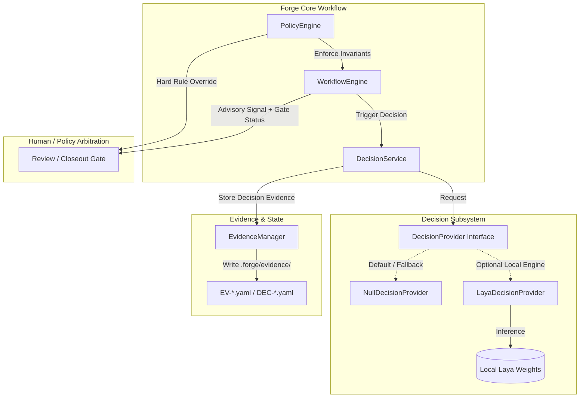

# Forge v0.1.4 Technical Specification: Laya Decision Layer
## Provider-Neutral Semantic Decision Architecture for Solo Engineering

---

## 1. Executive Summary & Laya Overview

Forge is a local-first software factory designed to turn a solo developer's software development process into a repeatable, deterministic engineering system. While Forge's core workflow and policy engine are strictly deterministic (evaluating toolchain exit codes, Git clean states, and path boundaries), certain lifecycle transitions benefit from **semantic interpretation**.

Specifically, answering questions such as:
- *"Does this task's implementation require enhanced human scrutiny beyond standard gate passes?"*
- *"Is the agent's summary congruent with the actual code diff and declared intent?"*
- *"Does this task carry non-obvious architectural risk or scope leakage?"*

Traditional Generative Large Language Models (LLMs) are sub-optimal for these discrete checkpoints: they introduce significant latency (3–8 seconds), non-deterministic text generation that requires fragile regex/JSON parsing, high computational or API costs, and failure modes rooted in hallucination.

### 1.1 What is Laya?
**Laya** is an open-source (Apache-2.0), non-generative, "System 1" decision model developed by Nandakishor M (Convai Innovations). Unlike autoregressive LLMs that generate token-by-token text, Laya functions as an encoder-based typed decision engine:

1. **Typed Questions In**: Accepts structured input state alongside typed questions (`choice`, `score`, `noul`).
2. **Calibrated Probabilities Out**: Evaluates all questions in a **single forward pass** (20–35 ms on a local GPU, ~60–140 ms on CPU).
3. **Non-Generative**: Generates zero output tokens. Outputs are mathematically bounded probability distributions over declared schemas.
4. **Local Execution**: Runs completely offline from local weights (322M–421M parameters, ~650 MB to 2.3 GB on disk), ensuring no proprietary source code or diff leaves the developer's workstation.

```
┌────────────────────────────────────────────────────────────────────────┐
│                          Laya Decision Engine                          │
│                                                                        │
│   Input State (JSON/Text)    ┌────────────────┐   Typed Probabilities  │
│   - Task goal & plan         │   Single Pass  │   - P(needs_review)    │
│   - Diff summary & stats  ──►│ 322M-421M Enc. ├──►- Confidence Score   │
│   - Failure diagnostics      │   (21-35 ms)   │   - Entropy Metric     │
│   Typed Question Definition  └────────────────┘                        │
└────────────────────────────────────────────────────────────────────────┘
```

### 1.2 Principle of Separation: Determinism vs. Semantic Advice
Forge maintains a strict boundary:
- **Forge Core & Policies**: Sole source of truth for repository state, filesystem mutations, command execution, and hard invariants.
- **Laya Decision Layer**: Advisory semantic signal. Laya provides probability estimates to inform workflow modes (e.g., escalating review scrutiny), but **can never override or bypass a Forge policy**.

---

## 2. System Architecture & Component Decoupling

The decision subsystem is isolated behind a provider-neutral interface (`DecisionProvider`). Forge core components depend solely on the abstract contract, ensuring Forge remains fully functional with zero machine learning dependencies when Laya is not installed.



### 2.1 Component Responsibilities

1. **`DecisionService`**: Internal orchestrator within Forge. Formats task context, selects the active `DecisionProvider`, applies local calibration thresholds, and records audit evidence.
2. **`DecisionProvider` (ABC)**: Abstract interface defining typed decision execution.
3. **`NullDecisionProvider`**: Zero-dependency default provider. Returns neutral/fallback decisions without external libraries.
4. **`LayaDecisionProvider`**: Concrete implementation executing local Laya model inference when the optional `laya` package is installed.
5. **`CalibrationEngine`**: Evaluates labelled datasets (`CalibrationSet`) against decision models, fits temperature scaling parameters, and computes precision/recall curves to establish data-driven thresholds.

---

## 3. Provider-Neutral `DecisionProvider` Interface

The decision interface is strictly typed using standard library types and Pydantic models.

```python
"""forge/decision/provider.py

Provider-neutral contract for semantic decision engines.
"""

from abc import ABC, abstractmethod
from datetime import datetime, timezone
from enum import Enum
from typing import Any, Dict, List, Optional
from pydantic import BaseModel, Field


class QuestionType(str, Enum):
    NOUL = "noul"       # Boolean / Yes-No with P(true)
    CHOICE = "choice"   # Categorical distribution over discrete options
    SCORE = "score"     # Ordinal distribution over ordered levels


class DecisionQuestion(BaseModel):
    id: str
    type: QuestionType
    instructions: str
    criteria: Optional[Dict[str, str]] = None  # For choice: {option: description}
    legend: Optional[List[str]] = None         # For score: [level_0, level_1, ...]


class DecisionRequest(BaseModel):
    decision_id: str
    question: DecisionQuestion
    context: Dict[str, Any]
    context_fingerprint: str
    timestamp: datetime = Field(default_factory=lambda: datetime.now(timezone.utc))


class DecisionResult(BaseModel):
    decision_id: str
    provider: str                      # e.g., "laya", "null"
    model_version: Optional[str] = None # e.g., "convaiinnovations/laya"
    question_id: str
    outcome: str                       # e.g., "true", "false", or categorical choice
    probability: float                 # Primary outcome probability in [0.0, 1.0]
    probabilities: Dict[str, float] = Field(default_factory=dict)
    confidence: float                  # Normalized certainty (1.0 - normalized entropy)
    latency_ms: int
    advisory_recommendation: str       # e.g., "standard_review", "enhanced_review"
    timestamp: datetime = Field(default_factory=lambda: datetime.now(timezone.utc))
    calibration_version: Optional[str] = None


class DecisionProvider(ABC):
    """Abstract interface for local and remote semantic decision providers."""

    @property
    @abstractmethod
    def provider_id(self) -> str:
        """Unique identifier of the provider implementation."""
        pass

    @property
    @abstractmethod
    def is_available(self) -> bool:
        """Returns True if the provider dependencies and weights are available."""
        pass

    @abstractmethod
    def evaluate(self, request: DecisionRequest) -> DecisionResult:
        """Executes a typed decision evaluation against the given request."""
        pass
```

### 3.1 `NullDecisionProvider` Implementation

The `NullDecisionProvider` requires zero dependencies and guarantees safe deterministic fallback:

```python
class NullDecisionProvider(DecisionProvider):
    """Safe fallback provider when no semantic decision model is installed."""

    @property
    def provider_id(self) -> str:
        return "null"

    @property
    def is_available(self) -> bool:
        return True

    def evaluate(self, request: DecisionRequest) -> DecisionResult:
        # Default to neutral probability (0.5) and minimal confidence (0.0)
        return DecisionResult(
            decision_id=request.decision_id,
            provider=self.provider_id,
            model_version="none",
            question_id=request.question.id,
            outcome="unknown",
            probability=0.5,
            probabilities={"unknown": 1.0},
            confidence=0.0,
            latency_ms=0,
            advisory_recommendation="standard_review",
            calibration_version=None,
        )
```

---

## 4. First Use Case: Enhanced Review Requirement

### 4.1 Problem Definition
In Forge, every task transitions through `VERIFY -> REVIEW`. However, the developer's attention is a scarce resource. 

- **Trivial tasks** (e.g., adding a test fixture or updating a docstring) that pass all verification gates require only quick spot checks.
- **High-risk tasks** (e.g., modifying unsafe blocks, changing database migration logic, altering error classification, or displaying subtle scope creep) require **enhanced review** with side-by-side AST diff inspection and failure trace audits.

Deterministic heuristics alone (e.g., counting lines changed) produce high false-positive rates on benign refactors and miss subtle logic shifts in small diffs.

### 4.2 Semantic Formulation for Laya

Following Laya's perceptual design guidelines:
1. **Ask what the state describes (perception), not what action Forge should take.**
2. **Compute all numbers, counts, and diff metrics in Python beforehand; pass conclusions in words.**
3. **Front-load critical task intent and changed symbols.**

#### State Representation Payload:
```json
{
  "task_goal": "Implement audio metadata cache validation and corrupted audio-file recovery in sonora-library",
  "allowed_paths": ["crates/sonora-library/"],
  "diff_summary": {
    "files_modified": ["crates/sonora-library/src/metadata.rs", "crates/sonora-library/src/repository.rs"],
    "lines_added": 45,
    "lines_deleted": 12,
    "scope_cleanliness": "all changes strictly within allowed paths",
    "modifies_unsafe_code": "no",
    "modifies_database_schema_or_migration": "no",
    "modifies_public_api": "yes",
    "verification_history": "initial verification failed on 1 check, remediated successfully on second attempt"
  },
  "agent_summary": "Added relaxed parsing mode for damaged audio containers and path-based fallback inference for missing tags."
}
```

#### Typed Question Definition:
```python
REVIEW_SCRUTINY_QUESTION = DecisionQuestion(
    id="review_scrutiny",
    type=QuestionType.NOUL,
    instructions="Does this software change involve non-trivial behavioral modifications, public API changes, error recovery logic, or subtle risk that warrants thorough human review?",
    criteria={
        "true": "Modifies core logic, error handling, public interfaces, recovery fallbacks, or security-sensitive paths.",
        "false": "Purely cosmetic changes, documentation updates, mechanical test additions, or simple localized typo fixes."
    }
)
```

#### Expected Output:
```json
{
  "decision_id": "DEC-20260923-001",
  "provider": "laya",
  "model_version": "convaiinnovations/laya",
  "question_id": "review_scrutiny",
  "outcome": "true",
  "probability": 0.884,
  "confidence": 0.768,
  "latency_ms": 28,
  "advisory_recommendation": "enhanced_review",
  "calibration_version": "v1-sonora"
}
```

---

## 5. Calibration & Evaluation Subsystem

Decision models must never be deployed with arbitrary uncalibrated thresholds (such as an ungrounded `0.5`). Forge v0.1.4 includes a local evaluation harness to calculate empirical operating points based on labelled engineering examples.

```
┌────────────────────────────────────────────────────────────────────────┐
│                        Calibration Data Model                          │
│                                                                        │
│   .forge/calibration/review_eval.yaml                                  │
│   ├── metadata: { dataset: "sonora-tasks", version: "1.0" }            │
│   └── examples:                                                        │
│       ├── [ID: EX-001] Task Context ──► Expected: TRUE (Needs Review)  │
│       ├── [ID: EX-002] Task Context ──► Expected: FALSE (Trivial)      │
│       └── [ID: EX-050] Task Context ──► Expected: TRUE (Needs Review)  │
└────────────────────────────────────────────────────────────────────────┘
```

### 5.1 Calibration Data Structures

```python
"""forge/decision/calibration.py"""

class CalibrationExample(BaseModel):
    id: str
    description: str
    context: Dict[str, Any]
    expected_outcome: str  # "true" | "false"
    notes: Optional[str] = None


class CalibrationSet(BaseModel):
    name: str
    version: str
    created_at: datetime
    question: DecisionQuestion
    examples: List[CalibrationExample]


class MetricReport(BaseModel):
    threshold: float
    total_examples: int
    true_positives: int
    false_positives: int
    true_negatives: int
    false_negatives: int
    accuracy: float
    precision: float
    recall: float
    false_negative_rate: float
```

### 5.2 Metrics & Threshold Optimization

For code review risk gating, **False Negatives are disproportionately dangerous** (classifying a risky change as trivial, bypassing human review). 

$$\text{Recall} = \frac{TP}{TP + FN} \quad (\text{Target: } \ge 0.95)$$
$$\text{False Negative Rate (FNR)} = \frac{FN}{TP + FN} \quad (\text{Target: } \le 0.05)$$

The calibration tool sweeps $\theta \in [0.10, 0.90]$ in increments of $0.02$ to identify the optimal threshold $\theta^*$ where $\text{Recall} \ge 0.95$ while maximizing $\text{Precision}$.

```
Threshold Sweep Curve:
Recall (Safety)   1.0 |========\
                      |         \
                  0.9 |          \====== (Selected Operating Point: θ = 0.62)
                      |                 \
Precision (Speed) 0.0 +------------------\----
                      0.0  0.2  0.4  0.6  0.8  1.0  (Threshold θ)
```

---

## 6. Integration Model Evaluation

We evaluate four potential integration architectures for embedding Laya into Forge:

| Criterion | 1. Direct Python Core | 2. Optional Python Extra (`forge[decision]`) | 3. Local HTTP Sidecar (`server.py`) | 4. Subprocess CLI Adapter |
| :--- | :--- | :--- | :--- | :--- |
| **Installation Complexity** | High (forces PyTorch/CUDA/MPS on all users) | **Low** (isolated to `pip install -e .[decision]`) | Medium (requires running/managing background daemon) | Low (requires separate binary/script on PATH) |
| **Startup Latency** | 3.2s on CLI launch (slows `forge status`) | **<10ms** (lazy import on demand only) | **<10ms** (model resident in background daemon) | 25–35s per CLI invocation (reloads weights each call) |
| **Memory Footprint** | 650 MB–1.5 GB resident in every CLI call | **0 MB** unless `forge decision` runs | 650 MB resident in daemon | 650 MB allocated and freed per process call |
| **Process Isolation** | None (crashes crash Forge CLI) | **High** (in-process try/except guard) | **Total** (separate process / memory space) | **Total** (separate OS process) |
| **Developer Ergonomics** | Poor (heavyweight install) | **Excellent** (single venv, optional flag) | Fair (must start/stop daemon) | Fair (subprocess pipes) |

### 6.1 Architectural Selection: Hybrid Architecture
1. **Primary Interface**: **Optional Python Extra (`forge[decision]`)** with lazy-loaded dynamic imports. 
   - Forge core never imports `torch` or `laya` at top-level.
   - If `laya` is present in the environment, `LayaDecisionProvider` loads weights lazily upon first decision request.
2. **Daemon/Sidecar Support**: `LayaDecisionProvider` supports an optional `endpoint` configuration (`http://127.0.0.1:8770/predict`). If a shared local sidecar is already running, Forge routes HTTP requests over loopback in ~20ms, bypassing in-process weight loading entirely.
3. **Graceful Fallback**: If neither is available, Forge automatically defaults to `NullDecisionProvider` with zero errors.

---

## 7. CLI Proposal

Minimal, purposeful CLI additions to support decision evaluation and calibration without bloat:

```bash
# 1. Inspect decision subsystem status and model availability
forge decision status [--path /path/to/repo]

# 2. Evaluate semantic risk for active or specified task
forge decision evaluate [--task-id TASK-001] [--json]

# 3. Run calibration evaluation on a labelled dataset
forge decision calibrate \
  --dataset .forge/calibration/review_scrutiny.yaml \
  --target-recall 0.95 \
  --output .forge/calibration/report.json
```

### Example CLI Output (`forge decision status`):
```text
Forge Semantic Decision Layer:
  Provider:           LayaDecisionProvider (Local)
  Model:              convaiinnovations/laya (English, 421M)
  Device:             Apple MPS (Accelerated)
  Status:             Available & Loaded (28 ms median latency)
  Active Calibration: review_scrutiny (v1.0, θ = 0.62, Recall = 96.2%)
```

---

## 8. Evidence & Data Model

Decision executions produce structured, immutable evidence stored directly in the filesystem under `.forge/decisions/` and referenced within `.forge/evidence/EV-*.yaml`.

```
.forge/
├── config.yaml
├── state.yaml
├── decisions/
│   ├── DEC-001.yaml
│   └── DEC-002.yaml
└── calibration/
    ├── review_scrutiny_dataset.yaml
    └── calibration_report.json
```

### 8.1 Schema: `DecisionEvidence` (`.forge/decisions/DEC-*.yaml`)

```yaml
id: DEC-001
task_id: TASK-001
timestamp: "2026-09-23T14:15:30Z"
provider: laya
model: "convaiinnovations/laya"
question_id: review_scrutiny
context_fingerprint: "sha256:7f83b1657ff1fc53b92dc18148a1d65dfc2d4b1fa3d677284addd200126d9069"

evaluation:
  outcome: "true"
  probability: 0.8842
  confidence: 0.7681
  latency_ms: 28

calibration:
  dataset: review_scrutiny_v1
  operating_threshold: 0.62
  recommended_mode: ENHANCED_REVIEW

policy_arbitration:
  hard_policy_triggered: false
  final_review_mode: ENHANCED_REVIEW
```

---

## 9. Safety Boundaries & Policy Arbitration

Laya operates strictly as an **advisory signal generator**. Hard policies configured in Forge remain absolute authorities.

```mermaid
flowchart TD
    TR[Task Ready for Review] --> CR[Compute Decision State]
    CR --> LD[Laya Evaluation]
    CR --> HP[Policy Engine Checks]
    
    LD -->|P >= 0.62| L_HIGH[Advise: ENHANCED REVIEW]
    LD -->|P < 0.62| L_LOW[Advise: STANDARD REVIEW]
    
    HP -->|Modifies Unsafe Code or Sec-Critical Files| P_FAIL[Rule: MANDATORY ENHANCED REVIEW]
    HP -->|Standard Allowed Scope & Gates Pass| P_PASS[Rule: POLICY PASS]
    
    L_HIGH --> ARB{Policy Arbitrator}
    L_LOW --> ARB
    P_FAIL --> ARB
    P_PASS --> ARB
    
    ARB -->|Any Policy Hard Rule Triggered| OUT_HARD[Final: MANDATORY ENHANCED REVIEW]
    ARB -->|Policy Pass + Laya High| OUT_ENHANCED[Final: ENHANCED REVIEW (Advisory)]
    ARB -->|Policy Pass + Laya Low| OUT_STD[Final: STANDARD FAST-PATH REVIEW]
```

### 9.1 Arbitration Rules

1. **Policy Supremacy**: If `PolicyEngine` detects violation of any invariant (e.g., changes outside `allowed_paths`, modifications to auth/crypto crates, or manual overrides), review mode is **forced to ENHANCED / MANUAL APPROVAL**, regardless of Laya probability.
2. **Advisory Escalation**: If all hard policies pass, but Laya outputs $P(\text{needs\_review}) \ge \theta^*$, Forge elevates `review.mode` to `enhanced` and alerts the developer in `forge review`.
3. **Advisory Fast-Path**: If all hard policies pass and Laya outputs $P(\text{needs\_review}) < \theta^*$ with high confidence, Forge presents a streamlined review summary.

---

## 10. First Experiment Plan (50–100 Labelled Tasks)

To validate whether Laya provides genuine semantic signal for Forge tasks, we design an empirical benchmark comparing three approaches against a ground-truth dataset.

### 10.1 Dataset Construction
Collect $N = 60$ historical engineering tasks from real repositories (including Sonora dogfooding tasks, Rust workspace refactors, dependency updates, and bug fixes):
- **30 Positive Examples (`needs_review: true`)**: Breaking API changes, tricky error fallbacks, concurrency logic, schema adjustments.
- **30 Negative Examples (`needs_review: false`)**: Pure doc comments, test fixture updates, non-functional code reformatting, localized unit test additions.

### 10.2 Tri-Party Comparison Matrix

| Evaluation Method | Inputs Evaluated | Expected Strength | Expected Weakness |
| :--- | :--- | :--- | :--- |
| **1. Deterministic Rule Baseline** | Lines changed ($>50$), file count ($>3$), path regex (`src/core/*`) | High reproducibility, zero latency | High false-positive rate on large refactors; misses subtle bugs in 2-line diffs |
| **2. Laya Decision Model** | Structured task goal + semantic diff summary + verification trace | Fast semantic understanding (25ms), graded probabilities | Potential sensitivity to prompt wording |
| **3. Ground-Truth Human Label** | Full code inspection by senior engineer | Authoritative gold standard | High human time cost |

### 10.3 Go / No-Go Criteria for Production Adoption

Laya integration will be considered successful and promoted if:
1. **$\text{Recall} \ge 0.95$**: Catches at least 95% of tasks requiring review.
2. **$\text{Precision} \ge 0.80$**: Reduces false alarms by $\ge 40\%$ compared to the lines-changed baseline.
3. **Inference Latency $\le 50\text{ ms}$**: Adds negligible overhead to `forge verify` and `forge review`.
4. **Zero Forge Core Breakage**: Runs cleanly with `NullDecisionProvider` when uninstalled.

---

## 11. Risks & Failure Modes

| Risk | Consequence | Mitigation |
| :--- | :--- | :--- |
| **Cold-Start Latency** | Loading 421M weights takes 25–35s on initial CLI run | Implement lazy loading (only load when decision commands execute) or connect to resident loopback sidecar. |
| **Weight Storage Footprint** | First download fetches 650 MB–2.3 GB of model weights | Make `laya` strictly optional (`forge[decision]`). Use explicit download commands with offline caching (`HF_HUB_OFFLINE=1`). |
| **Distribution Shift** | Model confidence degrades on unusual domain vocabularies | Require local dataset calibration (`forge decision calibrate`) before activating automated escalation. |
| **Silent False Negatives** | Laya incorrectly classifies a critical bug as trivial | Enforce Hard Policy Supremacy: safety-critical files always require human review regardless of model score. |

---

## 12. Explicit Non-Goals

1. **No Autoregressive LLM Chat**: Forge will not incorporate chat loops, conversational prompts, or free-form text generators in the decision layer.
2. **No In-Tree Machine Learning Training**: Forge v0.1.4 will not include gradient descent, backprop, or model fine-tuning code.
3. **No Database Dependencies**: Calibration sets and decision evidence will not use SQL databases, vector stores, or key-value daemons; standard JSON/YAML files are used.
4. **No Autonomous Policy Bypassing**: Laya decisions will never be permitted to approve code, commit changes, or bypass verification gates autonomously.

---

## 13. Future Extensions (Post-v0.1.4 Roadmap)

The generalized `DecisionProvider` contract establishes a foundational primitive that will support future capabilities without redesign:

1. **Intelligent Task Routing (`choice`)**: Classify incoming issue descriptions to select the optimal implementation strategy or subagent.
2. **Agent Model Selection (`score`)**: Estimate task complexity (0 to 4) to assign lightweight vs. heavyweight agent models.
3. **Step-Level Agent Guardrails (`noul`)**: Inspect intermediate tool calls during agent execution to intercept dangerous terminal commands before execution.
4. **LLM Escalation Cascade (`cascade`)**: Fast-path confident decisions via Laya ($<30\text{ms}$), escalating only uncertain cases ($\text{Confidence} < 0.50$) to slower, full-scale LLM reasoning.

---

## 14. Implementation Plan for Forge v0.1.4

```
┌────────────────────────────────────────────────────────────────────────┐
│                      Forge v0.1.4 Implementation                       │
├────────────────────────────────────────────────────────────────────────┤
│ Phase 1: Core Contract & Data Model                                    │
│   ├── Create forge/decision/provider.py (DecisionProvider, NullProvider)│
│   ├── Create forge/decision/models.py (DecisionRequest, DecisionResult)│
│   └── Update pyproject.toml with optional [decision] extra             │
├────────────────────────────────────────────────────────────────────────┤
│ Phase 2: Laya Adapter & Evidence Integration                           │
│   ├── Create forge/decision/laya_provider.py (Lazy-loaded Laya adapter) │
│   └── Update forge/core/evidence.py to record DEC-*.yaml artifacts     │
├────────────────────────────────────────────────────────────────────────┤
│ Phase 3: Calibration Harness & CLI                                     │
│   ├── Create forge/decision/calibration.py (Evaluation engine)         │
│   └── Add forge decision {status, evaluate, calibrate} to CLI          │
├────────────────────────────────────────────────────────────────────────┤
│ Phase 4: Benchmark Dataset & Validation                                │
│   ├── Assemble 60-example calibration dataset in tests/fixtures/       │
│   └── Execute tri-party benchmark experiment and verify safety rules   │
└────────────────────────────────────────────────────────────────────────┘
```
